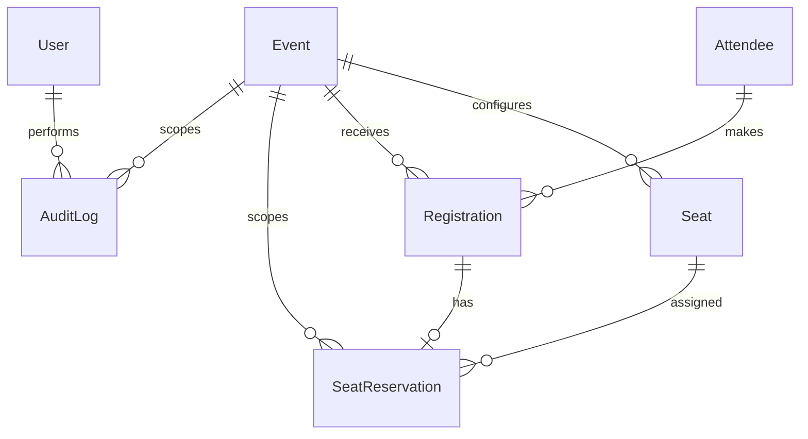

# Arquitectura propuesta

## Módulos

- **Web pública** (`frontend`): ficha de evento, formulario por pasos, mapa accesible, confirmación y consulta por código más correo.
- **Administración** (`frontend`): login, dashboard, eventos, asistentes, butacas, exportaciones y respuestas.
- **API** (`backend`): módulos NestJS `auth`, `users`, `events`, `registrations`, `seats`, `analytics` y `audit`.
- **Persistencia**: PostgreSQL mediante Prisma. Docker Compose ofrece el servicio local.

La web no accede directamente a la base de datos. La API valida entradas, identidad, roles y reglas de negocio. Los eventos son el límite de aislamiento: registros, mapa y estadísticas siempre se consultan por `eventId`.

## Modelo entidad-relación



- `User`: credencial administrativa y rol (`ADMIN`, `ORGANIZER`).
- `Event`: datos públicos, estado de publicación/inscripción y fechas.
- `Event.hallName/seatRows/seatColumns`: salón y dimensiones del mapa que configura el organizador para cada evento.
- `Event.formFields`: preguntas opcionales seleccionadas al crear cada formulario.
- `Attendee`: persona, email normalizado único.
- `Registration`: persona-evento, código de confirmación único, estado y respuestas.
- `Seat`: posición lógica por fila y columna, etiqueta visible y estado habilitado/bloqueado. Las coordenadas permiten distribuciones irregulares; las posiciones vacías representan pasillos.
- `SeatReservation`: asiento asociado a una inscripción, con expiración temporal o confirmación. Índice único por evento/asiento impide duplicidad.
- `AuditLog`: operaciones administrativas relevantes.

## Concurrencia de butacas

Crear la reserva dentro de una transacción: limpiar reservas expiradas, validar el asiento y crear la reserva con vencimiento corto. La unicidad `(eventId, seatId)` impide que solicitudes simultáneas ganen ambas; para reutilizar una butaca liberada, la fila liberada se reasigna al nuevo registro. Al confirmar, verificar vigencia y pertenencia al registro en la misma transacción que confirma la inscripción. Una tarea periódica libera vencidas. Bloquear un asiento ocupado debe rechazarse.

## Estructura

```text
backend/              NestJS: REST, autenticación, validación y Swagger
frontend/             Next.js: rutas públicas y administración
prisma/schema.prisma  Esquema relacional
docs/arquitectura.md
```

## Etapas

1. Configuración, PostgreSQL y esquema/migraciones.
2. Usuarios, login, roles y auditoría.
3. Eventos y configuración del auditorio.
4. Registro público y consultas por código.
5. Mapa y reservas transaccionales.
6. Gestión de asistentes, análisis y exportación.
7. Endurecimiento, verificación y despliegue.

Las respuestas libres pueden contener datos personales: limitar su exposición al rol organizador, evitar incluirlas en logs y definir retención/borrado antes de producción.

## Generación de formularios

El primer usuario administrador se crea en la tabla `User` mediante `npm run db:seed-admin`. El script lee `ADMIN_EMAIL` y `ADMIN_PASSWORD` desde el `.env` local y persiste un hash scrypt; el login siempre consulta la tabla. La API valida el JWT y vuelve a comprobar el estado y rol del usuario para crear un evento publicado con un slug y preguntas configurables. La ruta pública `/e/:slug` obtiene la definición y envía inscripciones a la API. La estructura separa explícitamente `frontend/` y `backend/`; el esquema Prisma se conserva en la raíz para migraciones.

Al publicar un evento, el organizador configura el nombre del salón, filas, columnas y cada posición como butaca disponible, bloqueada o pasillo. El backend crea las butacas en una transacción. La página pública muestra solo eventos publicados; el mapa representa los asientos ocupados, bloqueados y disponibles. La inscripción y la asignación de asiento se confirman juntas en una transacción protegida por la unicidad de `(eventId, seatId)`.
